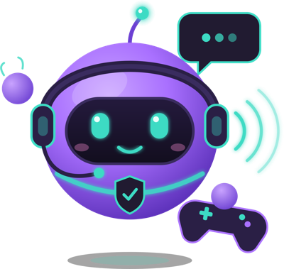
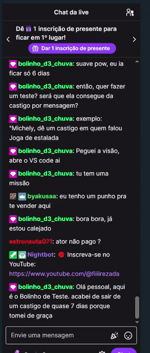
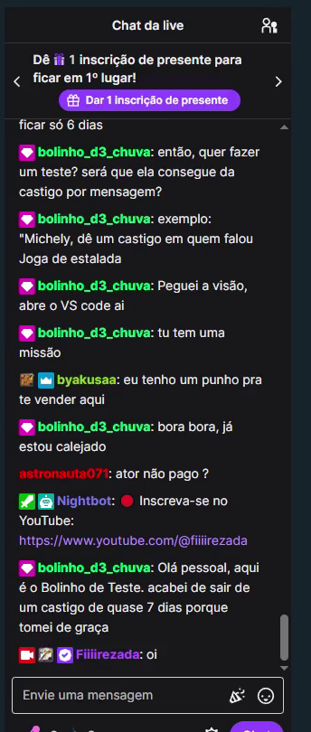
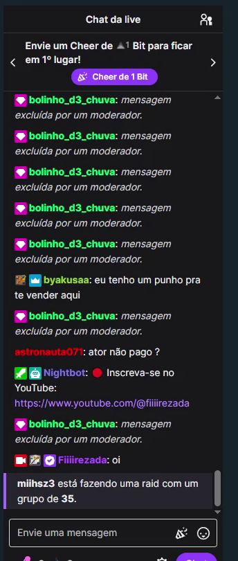
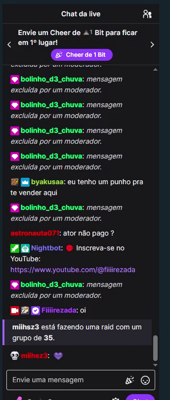
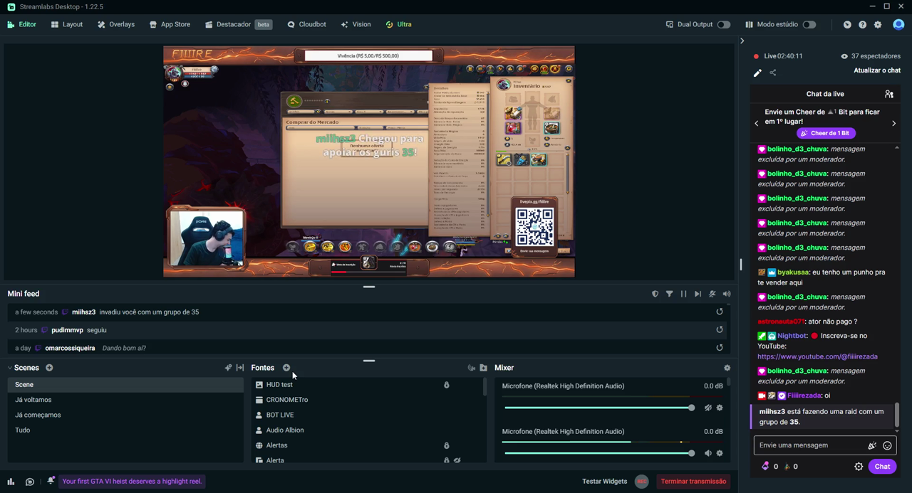

<p align="center">
  
</p>

# Assistente do Canal

Automação para moderar o chat de uma live na Twitch por voz, usando a Alexa e um modelo de IA.

Trabalho final da disciplina **Automação e Programabilidade em Redes**.

---

## 1. Sobre o projeto e problema resolvido

Durante uma live de jogos, o streamer fica com as mãos no controle ou no teclado o tempo todo. Para moderar o chat (mandar um aviso, dar um timeout em alguém ou tirar esse timeout), ele precisa parar o jogo, abrir o chat e digitar o comando com o nome exato do usuário. Isso faz perder jogadas, e os momentos em que mais é preciso moderar, como a chegada de um raid, são justamente os que menos dão para largar o jogo.

Com o Assistente do Canal, a moderação é feita falando com a Alexa, do jeito que se falaria com uma pessoa:

- "Alexa, peça para assistente do canal **digitar bem-vindos à live**"
- "Alexa, peça para assistente do canal **dar um castigo no Everton de 10 minutos**"
- "Alexa, peça para assistente do canal **liberar o Everton**"

Não existem palavras-chave fixas: uma IA interpreta a frase e transforma o pedido num comando estruturado. O nome do usuário pode chegar escrito errado pelo reconhecimento de voz, e a IA escolhe o login mais parecido entre quem está no chat.

**Ganho prático:** moderar o chat sem parar o jogo. O código responde em menos de 1 segundo, e o projeto foi testado numa live real do canal [twitch.tv/fiiiirezada](https://twitch.tv/fiiiirezada).

## 2. Arquitetura e fluxo de funcionamento


### Gatilho → Processamento → Saída

**Gatilho.** Um comando de voz na Alexa. A nuvem da Alexa transforma a fala em texto, identifica a intenção e dispara a função na AWS Lambda com um evento JSON (`IntentRequest`). A automação roda a cada comando, sem ninguém precisar abrir o computador.

**Processamento** (em `lambda/lambda_function.py`):

1. Monta a frase completa a partir da intenção e do texto livre que a Alexa enviou.
2. Busca na API da Twitch, em paralelo, quem está no chat (`GET /chat/chatters`) e quem está de timeout (`GET /moderation/banned`).
3. Envia a frase e essas listas para a IA na Groq, que responde **apenas com um JSON**:

   ```json
   {"acao": "timeout", "usuario": "bolinho_d3_chuva", "mensagem": null,
    "duracao_segundos": 60, "motivo": null, "confianca": 0.95}
   ```

4. Valida o JSON com regras no código (`if/else`):
   - a ação precisa ser `mensagem`, `timeout` ou `remover_timeout`;
   - timeout sem nome de usuário → pergunta o nome;
   - usuário que já está de castigo → avisa sem chamar a Twitch;
   - confiança abaixo de 0,75, usuário fora do chat ou nome que não parece com o que foi falado → pede confirmação por voz;
   - duração limitada entre 1 segundo e 14 dias (limite da Twitch).
5. Executa a ação na API da Twitch ou guarda o comando até a confirmação ("sim" / "não").

**Saída.**

- Mensagem publicada no chat (`POST /chat/messages`), timeout aplicado (`POST /moderation/bans`) ou removido (`DELETE /moderation/bans`).
- A Alexa confirma em voz alta: *"Pronto, bolinho_d3_chuva levou timeout de 1 minuto."*
- Cada comando fica registrado no CloudWatch: a frase entendida, o JSON gerado e o tempo de resposta.

### Tratamento de erros

- Todas as chamadas HTTP têm **timeout** (3 s para a Twitch, 4 s para a IA), porque a Alexa só espera cerca de 8 segundos.
- Respostas 4xx/5xx são verificadas com `raise_for_status()` e registradas no log com o corpo do erro.
- Quando a Twitch responde **401**, o token é renovado com o refresh token e a chamada é repetida uma vez.
- Os erros mais comuns viram respostas faladas, em vez de silêncio: usuário já de castigo, mensagem repetida, usuário inexistente, token expirado, Twitch fora do ar ou demorando, IA fora do ar ou demorando.
- Se faltar alguma credencial, o problema é registrado no log logo que a função inicia.

### Segurança

- A IA só interpreta a frase. Quem valida e executa é o código.
- O código confere se o usuário escolhido pela IA foi realmente falado, para não punir a pessoa errada.
- Não existe ban permanente, só timeout com limite.
- As credenciais ficam no arquivo `lambda/config.py`, que está no `.gitignore`. O repositório traz apenas o modelo `config_exemplo.py`.

## 3. Tecnologias e APIs utilizadas

| Item | Uso no projeto |
|---|---|
| **Python 3** | Linguagem da automação |
| `ask-sdk-core` | SDK da Alexa: recebe o evento e monta a resposta falada |
| `requests` | Requisições HTTPS para a Twitch e para a Groq |
| `python-dotenv` | Permite ler as credenciais também de um arquivo `.env`, se ele existir |
| `concurrent.futures`, `difflib`, `json`, `re` | Chamadas em paralelo, comparação de nomes e tratamento do JSON |
| **Alexa Skills Kit** | Reconhecimento de voz, modelo de interação em pt-BR e gatilho por evento |
| **AWS Lambda** (Alexa-hosted) | Onde o código roda |
| **Amazon CloudWatch** | Logs de cada execução |
| **API Helix da Twitch** | Ler o chat, enviar mensagens, aplicar e remover timeouts |
| **Twitch OAuth 2.0** | Token de usuário com escopos e renovação por refresh token |
| **Groq API** (compatível com OpenAI) | Modelo `openai/gpt-oss-120b` em modo JSON para interpretar a frase |
| **Protocolos** | HTTPS, REST, JSON, OAuth 2.0 e Bearer token |

Endpoints da Twitch usados: `GET /users`, `GET /chat/chatters`, `GET /moderation/banned`, `POST /chat/messages`, `POST /moderation/bans`, `DELETE /moderation/bans` e `POST id.twitch.tv/oauth2/token` (renovação do token).

### Como o projeto atende aos requisitos da disciplina

| Requisito | Onde está |
|---|---|
| 1. Motor de automação em Python | `lambda/lambda_function.py`, com requisições HTTP via `requests` |
| 2. Múltiplas integrações em rede | Alexa Skills Kit + API da Twitch + API da Groq, todas por HTTPS |
| 3. Transformação de dados estruturados | JSON da Alexa → JSON da IA → validações `if/else` → payload da Twitch |
| 4. Autenticação e credenciais | OAuth 2.0 (Twitch), Bearer (Groq), chaves em `config.py` fora do Git |
| 5. Gatilho e saída | Gatilho: comando de voz (evento da Alexa). Saída: ação no chat + resposta falada + log |
| 6. Tratamento de erros | Timeouts, `raise_for_status`, renovação de token em 401, respostas faladas para cada falha |

## 4. Pré-requisitos e como executar

### Pré-requisitos

- Conta de desenvolvedor da Amazon ([developer.amazon.com/alexa](https://developer.amazon.com/alexa)) e um dispositivo Echo na mesma conta (ou o simulador do console).
- Conta na Twitch com autenticação em dois fatores ativada.
- [Twitch CLI](https://github.com/twitchdev/twitch-cli) (no Windows: `winget install Twitch.TwitchCLI`).
- Conta na [Groq](https://console.groq.com) (o plano gratuito é suficiente).
- Git.

### Passo a passo

**1. Clonar o repositório**

```bash
git clone https://github.com/Janine2110/assistente-do-canal.git
cd assistente-do-canal
```

**2. Criar a skill da Alexa**

No [console da Alexa](https://developer.amazon.com/alexa/console/ask), crie uma skill **Custom**, idioma **Portuguese (BR)**, hospedagem **Alexa-hosted (Python)**, template *Start from Scratch*.
Em **Build → Interaction Model → JSON Editor**, cole o conteúdo de `skill-package/interactionModels/custom/pt-BR.json` e clique em **Save** e **Build skill**.

**3. Registrar o app na Twitch e gerar o token**

Em [dev.twitch.tv/console](https://dev.twitch.tv/console), registre um app com redirect `http://localhost:3000`, categoria *Chat Bot* e tipo *Confidential*. Anote o Client ID e gere um Client Secret. Depois:

```bash
twitch configure
twitch token -u -s "user:write:chat moderator:manage:banned_users moderator:read:chatters moderation:read"
```

Guarde o **User Access Token** e o **Refresh Token**.

**4. Criar a chave da IA**

Em [console.groq.com](https://console.groq.com) → **API Keys** → **Create API Key**.

**5. Configurar as credenciais**

Copie `lambda/config_exemplo.py` para `lambda/config.py` e preencha as cinco chaves:

```bash
cp lambda/config_exemplo.py lambda/config.py
```

**6. Publicar o código**

Na aba **Code** da skill, substitua `lambda_function.py` e `requirements.txt` pelos arquivos da pasta `lambda/`, crie o arquivo `lambda/config.py` com as suas chaves e clique em **Save** e **Deploy**. O código da skill Alexa-hosted fica privado na sua conta de desenvolvedor.

**7. Testar**

Na aba **Test**, ative o modo *Development* e digite, ou fale para a Echo Dot:

```
peça para assistente do canal digitar oi
peça para assistente do canal dar um castigo em [usuário] de 1 minuto
peça para assistente do canal tirar o castigo de [usuário]
```

Os logs ficam em **Code → CloudWatch Logs**.

## 5. Demonstração

Teste feito numa live real, com três comandos de voz em sequência:

<p align="center">
  
</p>

| 1. "digitar oi" | 2. "dar um castigo em bolinho" | 3. "tirar o castigo de bolinho" |
|---|---|---|
|  |  |  |
| A mensagem aparece no chat pela conta do canal | As mensagens do usuário são apagadas pelo timeout de 1 minuto | O timeout é removido e o usuário volta a falar |

Tela completa durante o teste (no meio dele ainda chegou um raid de 35 pessoas):



Trecho real do log no CloudWatch, mostrando a frase entendida e o JSON gerado pela IA:

```
[INFO] Contexto da Twitch em 0.1s (8 no chat, 6 punidos)
[INFO] IA respondeu em 0.4s no total
[INFO] Fala: 'manda bom dia no chat' -> {'acao': 'mensagem', 'usuario': None, 'mensagem': 'bom dia',
       'duracao_segundos': None, 'motivo': None, 'confianca': 0.95}
```

### Problemas encontrados durante os testes

- A Alexa entendia "modern life" no lugar do primeiro nome de chamada, "modera live". O nome foi trocado para "assistente do canal".
- A palavra "timeout" era reconhecida como "Darth Maul". Passamos a usar verbos em português (banir, dar um castigo, liberar) e ensinamos esses erros à IA.
- "Silenciar" era entendido como o comando de volume da própria Alexa.
- A Alexa escreve o artigo "um" como "1", e a mensagem saía como "1 oi gente". Isso foi corrigido no prompt.
- Quando a frase chegava sem nome, a IA escolhia um usuário que ninguém tinha citado. Encontramos o problema pelos logs e criamos uma trava no código.

## 6. Melhorias futuras (roadmap)

- **Novos comandos de moderação:** modo lento, chat só para seguidores e mensagens fixadas.
- **Histórico das ações de moderação** salvo num banco de dados, com um resumo no fim de cada live.

## Estrutura do repositório

```
assistente-do-canal/
├── .gitignore                   # mantém as chaves fora do Git
├── README.md
├── docs/                        # imagens do README
├── lambda/
│   ├── config_exemplo.py        # modelo das chaves (copiar para config.py)
│   ├── lambda_function.py       # código da skill (Alexa + IA + Twitch)
│   └── requirements.txt         # dependências Python
└── skill-package/interactionModels/custom/
    └── pt-BR.json               # modelo de voz da Alexa
```
